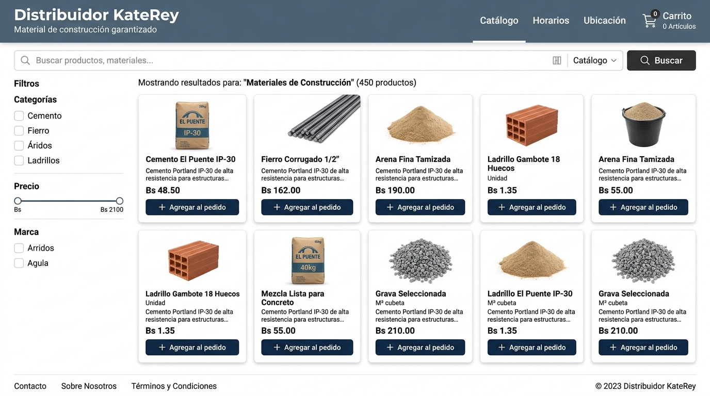

# Distribuidor KateRey - Catálogo y Preventa Web

**Estudiante:** Jhamil Najum Chino Huarachi  
**Cliente:** Distribuidor KateRey  
**URL:** [Próximamente disponible]
---
## ¿Qué problema resuelve?
Antes, el negocio tomaba pedidos a mano o por llamadas, lo que obligaba a contratar personal extra, encarecía los costos y causaba errores. Además, el cliente no recibía ningún recibo de respaldo.
Con esta web, el cliente puede ver el catálogo en vivo, buscar lo que necesita sin depender de un prevendedor, armar su carrito y generar un **recibo en PDF** que luego confirma al instante por WhatsApp.
---
## ¿Cómo lo construí?
- **HTML5:** Usé etiquetas semánticas (`header`, `nav`, `main`, `section`, `article`, `aside`, `footer`) para que la estructura fuera clara y accesible.
- **CSS Grid y Flexbox:** Usé **Grid** en el catálogo para que las tarjetas se acomoden solas en cualquier pantalla, y **Flexbox** en la barra de navegación, el buscador, el carrito y el tablero para alinear todo bien.
- **Diseño y Colores:** Elegí tonos industriales oscuros (`#1f2933`, `#12141c`) y detalles en verde éxito (`#2e7d32`) y azul (`#0284c7`) que combinan con el rubro de la construcción. La tipografía es la del sistema para que cargue rápido.
## Captura de Pantalla

## Mejoras que implementé en el camino
1. **Arreglé el buscador:** El botón no respondía porque tenía una variable duplicada (`formulario`) en dos archivos JavaScript distintos. Lo solucioné, le puse un icono de lupa y amplié la búsqueda para encontrar productos por nombre, categoría o descripción.
2. **Controlé el tamaño de los productos:** Cuando buscaba algo y salía un solo producto, la tarjeta se estiraba gigante y deformaba la imagen. Lo resolví cambiando a `auto-fill` en CSS Grid y fijando un ancho máximo para que la tarjeta se mantenga compacta.
3. **Generador de Recibos en PDF (`recivo.js`):** Añadí la librería `jsPDF` para que al confirmar el pedido se descargue automáticamente una nota de venta formal en PDF, con código único (`KR-XXXXX`), datos del cliente y la lista de productos con precios en Bolivianos.
4. **Envío por WhatsApp y compartir archivo:** Diseñé el mensaje de WhatsApp tipo factura y activé el botón para compartir el PDF directamente desde celulares usando la función nativa del sistema.
5. **Tablero de Carga (`tablero.js`):** Hice un tablero donde puedes arrastrar los materiales desde el stock hacia tu pedido, o usar los botones `(+)` y `(-)`. También dibujé una **volqueta en canvas** que se va llenando a medida que agregas productos.
---
##  Lo que más me costó
Lo más difícil fue encontrar por qué el buscador no funcionaba. En pantalla no salía ningún error, pero en la consola había un conflicto por declarar dos veces la misma variable en archivos distintos. También me costó calibrar el CSS Grid para que un solo producto no se estire cuando no hay más tarjetas al lado.
Otro dolor de cabeza fue hacer que el **carrito** y el **tablero** estuvieran sincronizados sin que se duplicaran los eventos cada vez que filtraba. Al final lo resolví usando una bandera (`dataset.escuchando`) para que cada botón "Agregar" solo tuviera un listener.
Y por último, el **camión en canvas** me costó un montón porque al principio no se veía nada. Resulta que el HTML tenía los nombres de las columnas mal (`almacen` en vez de `stock`), y el script buscaba elementos que no existían, así que se detenía sin avisar. Lo arreglé cambiando el HTML y ahora sí se llena la volqueta.

---
