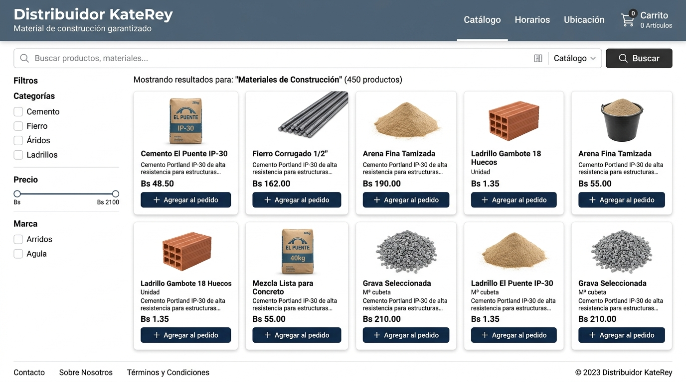

# Distribuidor KateRey - Catálogo y Preventa Web

**Estudiante:** Jhamil Najum Chino Huarachi  
**Cliente:** Distribuidor KateRey  
**URL:** [Próximamente disponible]

---

## ¿Qué problema resuelve?
El negocio dependía de tomar pedidos a mano o por llamadas contratando personal extra que encarecía los costos y causaba errores en los pedidos. Ademas, el cliente no recibía ningún tipo de recibo de respaldo.

Con esta web, el cliente consulta el catálogo en vivo y no depende de los prevendedores y de estar de manera presencial busca lo que necesita arma su carrito y genera un **recibo en PDF** que luego confirma al instante por WhatsApp por el momento.

---

## ¿Cómo lo construí?
- **HTML5:** Usé etiquetas semánticas (`header`, `nav`, `main`, `section`, `article`, `footer`) para estructurar de forma limpia la tienda, el carrito y el formulario.
- **CSS Grid y Flexbox:** Usé **Grid** en el catálogo para que las tarjetas se acomoden solas a cualquier pantalla, y **Flexbox** en la barra de navegación, el buscador y el carrito para alinear los controles.
- **Diseño y Colores:** Elegí tonos industriales oscuros (`#1f2933`, `#12141c`) y detalles en verde éxito (`#2e7d32`) que combinan con el rubro de la construcción, junto a una tipografía rápida del sistema.

## Captura de Pantalla

## Mejoras que implementé en el camino

1. **Arreglé el buscador:** El botón no respondía porque tenía una variable duplicada (`formulario`) en dos archivos JavaScript distintos que bloqueaba el código. Lo solucioné, le di estilo con un icono de lupa  y amplié la búsqueda para encontrar productos por nombre, categoría (ej. cemento, acero) o descripción.
2. **Controlé el tamaño de los productos:** Al buscar algo y encontrar un solo producto, la tarjeta se estiraba gigante ocupando toda la pantalla y deformaba la imagen. Lo resolví cambiando a `auto-fill` en CSS Grid y fijando un ancho máximo para que la tarjeta se mantenga compacta.
3. **Generador de Recibos en PDF (`recivo.js`):** Añadí la librería `jsPDF` para que al confirmar el pedido se descargue automáticamente una nota de venta formal en PDF con código único (`KR-XXXXX`), datos del cliente y lista de productos con precios en Bolivianos.
4. **Envío por WhatsApp y compartir archivo:** Diseñé el mensaje de WhatsApp tipo factura y activé el botón para compartir el PDF directamente desde celulares usando la función nativa del sistema.

## 💡 Lo que más me costó
Lo más difícil fue encontrar por qué el buscador no funcionaba: en pantalla no salía ningún error visible, pero en la consola había un conflicto por declarar dos veces la misma variable en archivos diferentes. También me costó calibrar el CSS Grid para que un solo producto no se estire cuando no hay más tarjetas a su lado.

